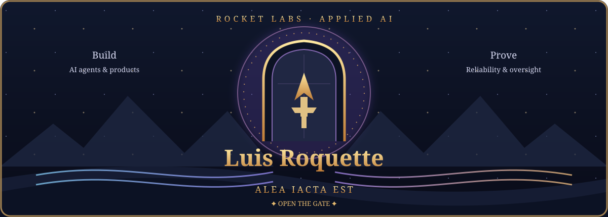
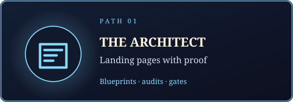
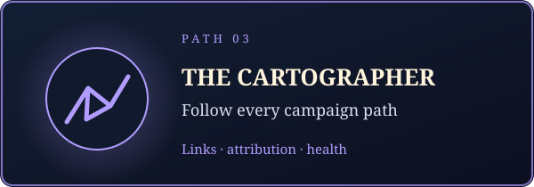
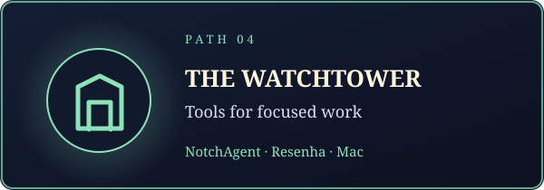
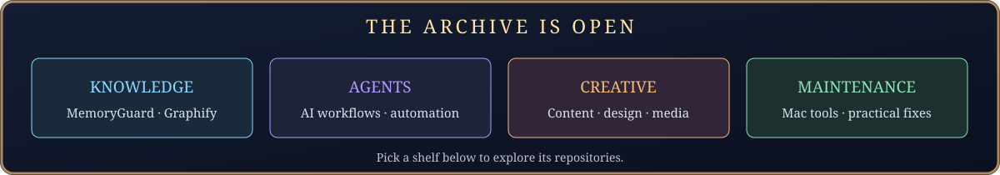
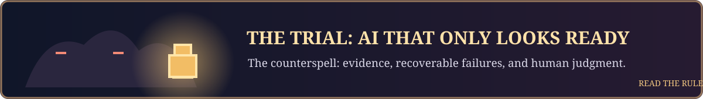
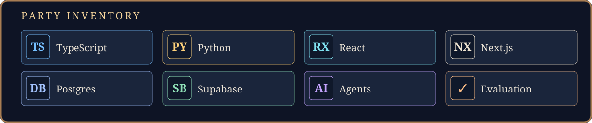

 

**Quest unlocked — Alea Iacta Est:** The die is cast. Build AI systems that solve real work, prove their behavior, and leave people in control.

  <strong>Applied AI for real workflows</strong> 
  Agents · reliability · evaluation · human oversight

## About me

I'm **Luis Roquette**. At [CF Gauss](https://cfgauss.com.br), I build AI products and business workflows for real operators. Rocket Labs is where I share the open-source tools, experiments, and practical lessons behind that work.

I care about what happens after the demo: clear inputs, testable rules, recoverable failures, and a person who knows when to step in. My work spans agent systems, marketing infrastructure, software for the Mac, and information products such as [SWEN](https://swen.ia.br) and [MOVA](https://movaevc.com.br).

> **Party rule:** Show the evidence. Keep the failure visible. Give people a clear way to intervene.

## Choose your path

Pick the tool that matches your next problem. Each card opens its repository.

<table>
  <tr>
    <td width="50%" valign="top"> <b><a href="https://github.com/luisroquette-labs/My_LP_Makes_Neil_Proud">The Architect</a></b> · Create and audit landing pages with explicit publication gates.</td>
    <td width="50%" valign="top"> <b><a href="https://github.com/luisroquette-labs/My_MailMKT_makes_Neil_Proud">The Courier</a></b> · Run email campaigns with a durable outbox, pacing, and an audit trail.</td>
  </tr>
  <tr>
    <td width="50%" valign="top"> <b><a href="https://github.com/luisroquette-labs/My_UTMs_Make_Me_Proud">The Cartographer</a></b> · Inspect links, attribution, and campaign health.</td>
    <td width="50%" valign="top"> <b><a href="https://github.com/luisroquette-labs/notchagent">The Watchtower</a></b> · Mac tools for attention and everyday work, including <a href="https://github.com/luisroquette-labs/resenha">Resenha</a>.</td>
  </tr>
</table>

 

- **Knowledge:** [MemoryGuard](https://github.com/luisroquette-labs/memoryguard) and [MemoryGuard Graph](https://github.com/luisroquette-labs/memoryguard-graph).
- **Agents:** [Marketing 4.0 Superpack](https://github.com/luisroquette-labs/marketing-4.0-superpack) and [AI BR Videos](https://github.com/luisroquette-labs/ai-br-videos).
- **Creative:** [Carousel Story Engine](https://github.com/luisroquette-labs/carousel-story-engine) and [My Blog Makes Neil Proud](https://github.com/luisroquette-labs/My_Blog_Makes_Neil_Proud).
- **Maintenance:** [Mac Storage Cleanup](https://github.com/luisroquette-labs/mac-storage-cleanup) and [NotchAgent Desk](https://github.com/luisroquette-labs/notchagent-desk).

## The trial: the die is cast

The hardest opponent is an AI workflow that looks convincing but cannot be checked. My answer is a simple operating loop:

1. **Define the task** and the point where a person decides.
2. **Build the smallest working system** with familiar tools.
3. **Test the behavior** on real edge cases.
4. **Watch the live result** and make failure recoverable.

## FAQ

<b>What does Rocket Labs build?</b>

Open-source tools and experiments around AI agents, marketing workflows, developer tools, and Mac software. The cards above are the best starting points.

<b>Where does CF Gauss fit?</b>

[CF Gauss](https://cfgauss.com.br) is the applied AI business. Rocket Labs is the public home for tools and ideas that can be shared openly.

<b>How do you decide an AI system is ready?</b>

It needs a defined job, evidence from tests and real use, visible failure states, and a clear path for human intervention.

## Tech inventory

Also in the toolkit: Vercel, Claude Code, Codex, and practical automation.

## Connect

  
  
  
  

Original fantasy artwork for Rocket Labs · no dragons were copied.

